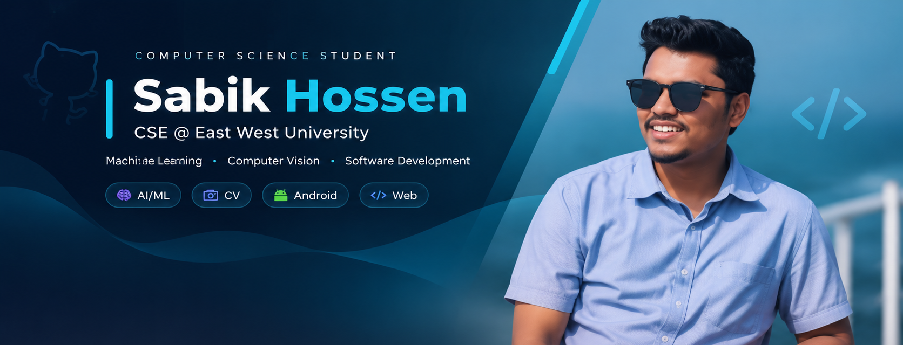

<!--
  GitHub Profile README — Sabik Hossen
  Repository: https://github.com/SabikHossen07/SabikHossen07
  Keep Sabik-GitHub-Banner-Cropped.png next to README.md.
  Animated logo GIFs: https://github.com/Anmol-Baranwal/Cool-GIFs-For-GitHub (MIT)
-->

<!-- HERO BANNER -->

  

   

  
  
  

    
  

---

### 👋 About Me

I'm **Sabik Hossen**, a Computer Science & Engineering student at **East West University, Bangladesh**. I enjoy combining software development, machine learning and problem-solving to build practical projects.

- 🤖 **Exploring:** Machine Learning, Computer Vision and AI-powered applications
- 💻 **Building:** Full-stack web applications and academic projects
- 🧠 **Interested in:** Algorithms, applied AI and software engineering
- 🌱 **Currently learning:** New tools and better software development practices

---

### ⚡ My Tech Stack

<b>Animated Developer Logos</b>

<!-- Moving logos: sourced from Anmol-Baranwal/Cool-GIFs-For-GitHub (MIT). -->

  
  
  
  
  
  
  
  

<b>Languages, Databases &amp; Tools</b>

  
    
  

---

### 🚀 Selected Projects

A few projects that represent my work in web development, machine learning and algorithms.

<table>
  <tr>
    <td width="50%" valign="top">
      <h3>🎓 CapTrack</h3>
      <b>Capstone Project Lifecycle Management</b>
      
A university capstone management platform for team collaboration, supervisor feedback, project milestones and submissions.

      
<code>React</code> <code>Node.js</code> <code>MongoDB</code>

      
    </td>
    <td width="50%" valign="top">
      <h3>🎬 CineBook</h3>
      <b>Online Movie Ticket Booking System</b>
      
A PHP/MySQL booking system with movie listings, showtimes, seat selection, tickets and management tools.

      
<code>PHP</code> <code>MySQL</code> <code>JavaScript</code>

      
    </td>
  </tr>
  <tr>
    <td width="50%" valign="top">
      <h3>🚕 Taxi Fare Prediction</h3>
      <b>Machine Learning Regression</b>
      
A regression project exploring how trip duration, distance, traffic and weather conditions relate to taxi fares.

      
<code>Python</code> <code>pandas</code> <code>scikit-learn</code>

      
    </td>
    <td width="50%" valign="top">
      <h3>🗺️ GraphRoute BD</h3>
      <b>Shortest-Path Algorithms</b>
      
A C++ graph project applying Dijkstra, Bellman-Ford and Floyd-Warshall to a Bangladesh-focused route network.

      
<code>C++</code> <code>Graphs</code> <code>Algorithms</code>

      
    </td>
  </tr>
</table>

  

---

### 📊 GitHub Activity

  
  
    
  
    
  

---

  <h3>🤝 Let's Connect</h3>
  
Open to learning, collaborating and exchanging project ideas.

  
  
    
  <em>Keep Learning · Keep Building · Keep Improving</em>

